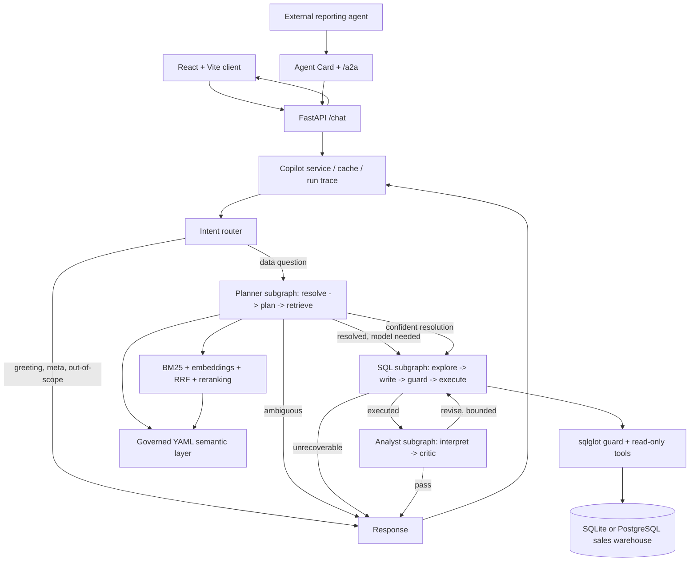

# BI Copilot — Engineering Case Study

> **Project type:** Portfolio implementation / intelligent BI over a real public e-commerce dataset (Olist, Kaggle)  
> **Core stack:** Python, FastAPI, LangGraph, LangChain tool calling, SQLAlchemy, sqlglot, React, TypeScript, Vite, Recharts, Docker  
> **Retrieval and data options:** BM25, embeddings, reciprocal rank fusion, reranking; SQLite or PostgreSQL; in-memory vectors, pgvector, or Milvus  
> **Repository:** https://github.com/wenjun78/bicopilot  
> **Live deployment supplied by the project owner:** https://bicopilot.onrender.com/  
> **Related documentation:** [README](README.md) · [Business glossary](semantic/glossary.md) · [Metric definitions](semantic/metrics.yaml) · [Evaluation runner](eval/run.py)

## The data

[Olist's Brazilian E-Commerce dataset](https://www.kaggle.com/datasets/olistbr/brazilian-ecommerce) (Kaggle, CC BY-NC-SA 4.0): 99,441 orders, 112,650 item lines, 99,224 reviews, 103,886 payments, 32,951 products, 3,095 sellers and about one million geolocation points from September 2016 to August 2018, in BRL. `data/build_olist.py` builds a star schema (`fact_orders`, `fact_order_items`, `fact_payments`, `fact_reviews`, `dim_customer`, `dim_seller`, `dim_product`, `dim_date`, `dim_geo`) and resolves the master-data problems in the source: a golden customer record merges the per-order `customer_id` values into 96,096 people, duplicate reviews collapse to the latest, uncategorised products go to `unknown`, and geolocation is collapsed to one row per zip prefix. The semantic layer and the data dictionary are written against this schema; the deterministic evaluation runs 60 questions with hand-written gold SQL over it.

## 1. Executive summary

BI Copilot converts natural-language questions about a **real e-commerce warehouse** (Olist, 99,441 Brazilian orders, 2016-2018) into business-defined SQL, executes queries against a constrained set of warehouse tables, and returns an answer, a one-line account of how it was calculated, a chart, the underlying rows, the SQL, and (for analysts) a trace of agent activity. Around the chat sit the surfaces a BI team expects: a guarded SQL console, a profiled data dictionary with a join map, downloads (CSV, Excel, JSON, text, Markdown), pasted PDFs or screenshots as context, and an analyst/viewer role split with column masking.

Its distinguishing design choice is the **governed semantic layer**: the meanings of revenue, late delivery, customers (golden records, not per-order ids), calendar periods and dimensions are defined in YAML rather than inferred afresh by a language model for every query. A deterministic SQL compiler provides a constrained starting point; the LLM path performs planning, tool use, SQL refinement, analysis and critique **only where the layer could not resolve the question on its own** (the "confident resolution" fast path, section 7). The service can also operate with a deterministic no-key substitute for development and automated testing.

**Evidence boundary:** This is a working software prototype on a public dataset, not a documented production rollout for business users. A deployed URL and CI configuration do not themselves demonstrate real-user adoption, service availability, measured financial returns, or production-scale concurrency. The project's reported 100% SQL execution accuracy applies to its **deterministic evaluation path**, not to a separately verified LLM-backed run.

## 2. Background and business problem

Business users often need answers such as:

- “Top five customers by gross margin last quarter.”
- “Revenue by region 2017.”
- “Late delivery rate by region 2018.”
- “What was the margin in EMEA?”

A conventional BI workflow requires a knowledgeable analyst to translate these questions into the correct warehouse joins, filters, aggregations, and reporting periods. Allowing an LLM to write free-form SQL removes some manual effort but introduces a more serious risk: **SQL can run successfully and still answer the wrong business question**.

Concrete failure modes motivating this project:

| User asks | Potential failure | Required interpretation |
|---|---|---|
| Revenue | Cancelled or returned lines are counted | Completed order lines only, in USD |
| Gross margin | Margin amount is confused with margin percentage | Ask a clarifying question for an ambiguous “margin” |
| Revenue by region | Sales representative's region is used | Customer region unless the question explicitly refers to reps |
| Last quarter | The current calendar quarter is assumed | Last *complete calendar quarter* relative to the warehouse's as-of date |
| Average order value | Order lines are counted as separate orders | Revenue divided by distinct completed order IDs |
| Top five customers | An unordered result or incorrect LIMIT is returned | Sort by requested metric and return five groups |

These examples are grounded in [``semantic/metrics.yaml``](semantic/metrics.yaml) and [``semantic/glossary.md``](semantic/glossary.md).

## 3. Objectives, boundaries, and success criteria

**Primary objective:** demonstrate an inspectable, safer natural-language interface to a sales warehouse, with business definitions controlled separately from prompts.

**Functional objectives**

1. Interpret a question into metrics, dimensions, filters, time periods, and ranking requirements.
2. Detect ambiguity and request clarification rather than silently guess.
3. Retrieve the relevant metric, field, and table definitions.
4. Generate, validate, and execute read-only SQL with bounded retries.
5. Produce a business explanation plus chart/table/SQL/trace output.
6. Expose the capability through both a web API and a limited agent-to-agent interface.
7. Exercise the same application flow in automated tests without requiring a paid LLM API.

**Engineering acceptance criteria represented in code**

- Only one parsed SELECT-style statement, and only allowed warehouse tables, may pass the SQL guard.
- Queries receive a row cap and execution timeout.
- Generated SQL results are compared with hand-authored reference queries in the evaluation harness.
- The system distinguishes answers, clarification requests, refusals, and other statuses.
- Failed optional-model execution can fall back to a clearly labelled deterministic path.
- Evaluation and unit tests run in CI against the Olist warehouse built from the committed source files.

**Outside the demonstrated scope:** enterprise identity integration, per-user row-level authorization, real customer data, full A2A protocol compliance, guaranteed factual accuracy from an LLM, measured ROI, and proven scale under sustained production traffic.

## 4. Architecture and major components



The orchestration is in [``src/bicopilot/agents/graph.py``](src/bicopilot/agents/graph.py). Specialist subgraphs are implemented separately in [``planner.py``](src/bicopilot/agents/planner.py), [``sql_agent.py``](src/bicopilot/agents/sql_agent.py), and [``analyst.py``](src/bicopilot/agents/analyst.py).

| Component | Responsibility | Code |
|---|---|---|
| Router / supervisor | Classifies requests and selects an agent or direct response | [``agents/graph.py``](src/bicopilot/agents/graph.py) |
| Planner | Resolves metrics and dimensions, forms a structured plan, retrieves context | [``agents/planner.py``](src/bicopilot/agents/planner.py) |
| Semantic layer | Declares metric expressions, business filters, joins, fiscal calendar and aliases | [``semantic.py``](src/bicopilot/semantic.py), [``metrics.yaml``](semantic/metrics.yaml) |
| Retrieval | Combines lexical, vector and structured metadata hits | [``retrieval.py``](src/bicopilot/retrieval.py) |
| Reranker | Reorders fused documentation candidates | [``rerank.py``](src/bicopilot/rerank.py) |
| SQL agent | Uses bounded tools, drafts SQL, applies guard, executes, repairs | [``agents/sql_agent.py``](src/bicopilot/agents/sql_agent.py) |
| SQL guard / executor | Syntax and table restrictions, row limits, dialect conversion, timeouts | [``sqlguard.py``](src/bicopilot/sqlguard.py), [``db.py``](src/bicopilot/db.py) |
| Analyst / critic | Generates summary/chart and checks answer against plan and result | [``agents/analyst.py``](src/bicopilot/agents/analyst.py) |
| API / service | Handles requests, answer caching, fallback, trace recording and rate limits | [``api.py``](src/bicopilot/api.py), [``service.py``](src/bicopilot/service.py) |
| A2A and reporter | Exposes task-shaped JSON-RPC messages; compiles a briefing using the API | [``a2a.py``](src/bicopilot/a2a.py), [``reporting_agent.py``](agents/reporting_agent.py) |
| Data dictionary | Business descriptions plus live column profiles; served to the UI, indexed for retrieval, answers schema questions | [``dictionary.py``](src/bicopilot/dictionary.py), [``dictionary.yaml``](semantic/dictionary.yaml) |
| Access control | Analyst/viewer roles; masked columns rewritten on the SQL AST, post-filtered in rows, withheld from prompts; viewers receive no trace | [``access.py``](src/bicopilot/access.py) |
| Console, exports, attachments | Guarded ad-hoc SQL, result downloads, PDF/image/CSV text extraction into the planner's context | [``api.py``](src/bicopilot/api.py), [``export.py``](src/bicopilot/export.py), [``attachments.py``](src/bicopilot/attachments.py) |
| User interface | Chat (answer, method, chart, rows, SQL, trace), SQL console with schema browser, dictionary with join map; light and dark; phone to desktop | [``web/src/App.tsx``](web/src/App.tsx), [``ResultView.tsx``](web/src/components/ResultView.tsx), [``SchemaMap.tsx``](web/src/components/SchemaMap.tsx) |

### Deployment paths

- **Local/zero-infrastructure path:** SQLite, in-memory vectors, deterministic fake LLM, and in-process cache; suitable for tests and reproducible demonstrations.
- **Optional model/database path:** configurable OpenAI-compatible model, embeddings, PostgreSQL with pgvector, and Redis. Configuration supports these; it does not prove they are enabled in a particular live service.
- **Web deployment:** Docker builds the React frontend and Python API into one image. On Render the frontend can use the same-origin API. The portfolio site hosts a static copy of the same frontend, built with the Render API as its base URL.
- **A2A automation:** a separate reporting client uses the Agent Card and JSON-RPC message/send surface; a scheduled GitHub Actions workflow can produce Markdown reports.

## 5. End-to-end implementation walkthrough

**Example question:** “top 5 categories by revenue last quarter”.

1. **Route.** The router identifies a warehouse-related data question.
2. **Resolve.** The semantic resolver maps “revenue” to the delivered-order GMV metric, “categories” to the product category dimension, “top 5” to descending ranking with a five-row limit, and “last quarter” to calendar 2018-Q2 relative to the dataset's as-of date.
3. **Plan.** The planner produces structured fields for metric, dimension, filters, period, ordering and clarification status. An LLM may refine the draft, but metric identifiers are checked against the semantic catalog.
4. **Retrieve.** The retriever collects metric cards, table descriptions, and business definitions. BM25 matches exact field or metric names; embedding search helps with alternate phrasing; RRF combines ranks; reranking prioritizes the context handed to the SQL writer.
5. **Explore.** The SQL agent can call read-only tools to describe an allowed table, sample valid values, or validate draft SQL. Real-model tool calls are bounded by configuration.
6. **Compile and write.** A deterministic compiler emits a business-rule-aware draft; the LLM SQL writer can refine it. With the fake provider, the deterministic result is used instead.
7. **Guard and execute.** sqlglot parses the statement and checks query type, table allowlist and row limit. The executor runs it with a timeout. A failed attempt is recorded and may be retried up to the configured repair bound.
8. **Interpret and critique.** The analyst creates a summary and chart specification. A critic reviews the question, plan, SQL and selected results; a bounded revision may return control to the SQL agent.
9. **Respond and trace.** The API returns the answer plus SQL, rows, attempts, retrieval metadata, tool steps, timing and agent trace.

**Illustrative metric contract (from the Olist semantic layer):**

```yaml
revenue:
  label: Revenue (GMV)
  base: fact_order_items
  sql: "SUM(oi.price)"
  filters: ["oi.status = 'delivered'"]
  format: currency
```

This contract instructs the deterministic compiler to sum item prices only on delivered order lines, in BRL and without freight. Grouping by product category joins `fact_order_items` to `dim_product`, while the time filter joins `dim_date`. **Important distinction:** a model-generated SQL statement is not independently proven to comply with every business definition merely because it passed the SQL guard. Structural restrictions and business correctness are evaluated separately.

With the as-of date of **2018-08-31** (the last complete month in the data), “last quarter” resolves to **calendar 2018-Q2 (April–June 2018)**. The Olist semantic layer explicitly sets `calendar: calendar` with **no fiscal-year offset**.

## 6. Technical concepts explained in this implementation

| Term | What it means | How BI Copilot uses it |
|---|---|---|
| **Intelligent BI** | Business intelligence that accepts natural-language requests and explains structured data | Natural-language queries produce SQL, result rows, summaries and charts |
| **NL-to-SQL / text-to-SQL** | Mapping a user's question to a database query | Planner → semantic SQL draft → optional model refinement → guard → execution |
| **Semantic layer / governed metrics** | Centrally maintained business definitions independent of the model prompt | YAML expressions, aliases, mandatory filters, dimensions and calendar rules |
| **Data grain** | What one database row represents | ``fact_orders`` has one row per order; ``fact_order_items`` has one row per item line. The compiler chooses the appropriate base for each metric |
| **RAG** | Retrieving relevant information and placing it in the model's context | The SQL agent receives metric and schema documentation selected for the question |
| **Embeddings** | Numeric representations used to measure similarity between text | Optional model embeddings for dense semantic retrieval; a deterministic hash-based alternative is used without a key |
| **BM25** | Lexical retrieval scoring that rewards matching query terms | Exact names and business terms can be found without depending on dense vectors |
| **Hybrid retrieval** | Combining multiple search strategies | BM25 + dense similarity + structured resolver hits |
| **RRF (reciprocal rank fusion)** | Rank-based fusion that reduces dependence on incomparable raw search scores | Combines lexical and dense candidate rankings |
| **Reranking** | Second-pass ranking of shortlisted retrieved items | Lexical, optional FlashRank cross-encoder, or LLM-scored candidates |
| **LangGraph** | Stateful graph framework for orchestrating steps and conditional transitions | Supervisor and three compiled agent subgraphs with explicit branching |
| **Plan-and-Execute** | Separate the planned steps from their execution | Structured planner resolves intent before SQL agent execution |
| **ReAct** | Reasoning interleaved with tool invocation and observations | SQL exploration calls ``describe_table``, ``sample_values`` or ``validate_sql``, then uses observations |
| **Reflection / critic loop** | Reviewing outputs and optionally revising them | Critic can supply a fix hint for one bounded return to SQL generation |
| **Tool calling** | A model invokes registered functions with structured arguments | LangChain bound, read-only SQL metadata and validation tools |
| **Structured output** | Restricting model responses to typed schemas | Pydantic models for routing, SQL, analysis and critique |
| **SQL AST / sqlglot** | Parsed SQL represented as a structured syntax tree | Validates and rewrites one permitted statement rather than checking only text keywords |
| **SQL dialect transpilation** | Rewriting SQL for another database engine | PostgreSQL-shaped generated SQL can be emitted for SQLite or PostgreSQL |
| **Read-only execution** | Query execution intended not to change source data | SELECT-only checks, constrained tools and row/timeout limits; a restricted DB account is still advisable |
| **A2A (agent-to-agent)** | An interface through which separately running agents exchange tasks | Agent Card discovery and a JSON-RPC ``message/send`` endpoint used by the reporting client |
| **Agent trace / observability** | Recording intermediate decisions and execution steps | Agent nodes, SQL attempts, retrieved chunks and timing are surfaced in the UI/API |
| **Deterministic fallback** | Predictable non-LLM path when a model is unavailable | Semantic compiler and fake-model graph can answer supported queries and label the fallback |
| **Execution accuracy** | Whether generated queries return the same result as reference SQL | Compares query result sets rather than SQL string equality |

### Differences worth understanding

- **LangChain versus LangGraph:** LangChain provides model/tool integrations; LangGraph defines the multi-step state machine and conditional routing used here. They are complementary, not interchangeable.
- **RAG versus fine-tuning:** This project retrieves current metric and schema definitions at runtime. There is no evidence in this repository that the model has been fine-tuned.
- **Multi-agent inside LangGraph versus A2A:** The supervisor's planner, SQL and analyst nodes share in-process graph state; the reporting agent is a separate client communicating over an HTTP task interface. Calling either arrangement “multi-agent” does not make them the same architecture.
- **SQL syntax correctness versus business correctness:** Successful parsing or execution does not establish the right metric or join. The semantic layer and gold-result evaluation address the latter separately.
- **Deterministic result versus LLM result:** The zero-key path proves a fixed compiler can handle covered queries; it does **not** establish the real-model answer rate, tool-use reliability or hallucination frequency.

## 7. Design decisions, alternatives, and trade-offs

### A. Governed compiler before free-form model generation

**Decision:** map questions to documented metric and dimension IDs, and construct a canonical SQL draft before optional LLM refinement.

**Why:** an LLM can invent joins or silently choose an incorrect business definition. Centralized definitions make the expected business meaning inspectable and testable.

**Trade-off:** the compiler supports defined patterns well but is less flexible on complex multi-fact analytics and arbitrary window functions; the model path attempts cases outside the compiler's coverage.

### B. Hybrid retrieval rather than vector-only search

**Decision:** use BM25, optional dense embeddings, structured matched-metric hits, rank fusion and a second-stage reranker.

**Why:** exact metric names and field IDs are better handled by lexical matching, whereas alternative phrasing may benefit from semantic similarity. Important structured results are pinned to context.

**Trade-off:** more retrieval stages increase processing, configuration and debugging work. For the small glossary, an in-memory approach is simpler than running a dedicated vector service.

### C. Three specialist subgraphs rather than one unconstrained agent

**Decision:** separate planning, SQL construction/execution, and interpretation/critique.

**Why:** each stage has a narrower contract and a distinct trace. Failures can be attributed to routing, retrieval, SQL, or explanation rather than one opaque agent call.

**Trade-off:** extra model calls can increase cost and latency. The supervisor therefore uses bounded tool calls, SQL repairs and critic revisits.

### D. Deterministic fallback and an evaluation oracle

**Decision:** use the same overall graph in the no-key path, with a deterministic fake model and compiler.

**Why:** local tests and CI remain reproducible even without provider availability or paid API keys; the deterministic SQL path is a reference for regression tests.

**Trade-off:** deterministic success can be misleading if presented as LLM performance. Model-backed accuracy needs an independently executed evaluation.

### E. SQL guard plus application-level controls

**Decision:** parse SQL, require one SELECT-style statement, allow only known warehouse tables, cap rows and timeouts, use read-only tools, and limit public query frequency.

**Why:** generated SQL should not directly become unrestricted database access.

**Trade-off:** the current guard is not a full authorization engine or proof of business-rule compliance. Database credentials and row-level access policy must be secured separately in an enterprise deployment.

### F. SQLite and Postgres compatibility

**Decision:** use SQLAlchemy and a calendar dimension for time groupings, plus SQL transpilation.

**Why:** a low-cost local demo and a database-backed deployment can share most of the code.

**Trade-off:** differing query planners, numeric types and SQL support still require separate backend tests.

### G. Confident resolution: the model only where it adds value

The full agent path costs six or seven sequential model calls (router, plan correction, LLM rerank, up to four ReAct tool rounds, SQL write, analyst, critic). Measured on the live service it took 30-40 s per question, which no business user tolerates. The fix is not a faster model but fewer calls: when the semantic layer names the metric, nothing is ambiguous, no word of the question is left unexplained and no attachment or clarification reply is in play, the plan and the SQL are taken from the compiler (correct by construction), the router and the reranker run without the model, and the model is asked only to interpret the rows and to criticise that interpretation. A residual word ("excluding", "place"), an ambiguous phrase or a pasted file brings the planner and the tool-using SQL agent back. The trace records which path ran and why.

One live measurement (31 Oct 2026, "late delivery rate by region 2018", Render free tier, Neon Postgres, gpt-5.6-sol): 14.3 s total, of which router 1.8 s, retrieval with LLM rerank 5.5 s, Neon query 1.2 s, analyst 3.3 s, critic 2.4 s. The router and rerank model calls were removed from the fast path afterwards, so the expected figure is about 9 s; that expectation has not yet been re-measured.

### H. Every answer says how it was calculated

A number without its method is not auditable by the people who have to act on it. The analyst writes a one-sentence method from the SQL; the semantic layer adds the metric definition, formula, mandatory filters, the period the question resolved to, the grouping and the question's own filters. The UI shows this as "How this was calculated" under the statement; it is produced deterministically, so it is present even when the model is unavailable.

## 8. Failure handling and operational considerations

| Failure / condition | Code behaviour | Remaining risk |
|---|---|---|
| “Margin” is ambiguous | Returns clarification options before querying | Unrecognized ambiguity may still yield the wrong metric |
| Unknown table or disallowed SQL | sqlglot guard rejects the statement | Allowed SQL may still be business-incorrect |
| SQL error or timeout | Records attempt and executes a bounded repair loop | Some questions remain unsupported |
| LLM call fails | Optional deterministic fallback with an explicit notice; degraded answers are not cached | Fallback only covers supported deterministic patterns |
| Repeated identical question | Cached answer can be served, keyed on the semantic YAML version | In-memory cache is not shared across replicas |
| Public request abuse | Visitor and global rate limits; admin protection for run-history endpoints when token configured | Visitor limits are process-local; deployment topology matters |
| Render free-tier wake-up | Frontend polls health endpoint and can display precomputed examples | Cold-start latency and availability are not measured here |
| A2A client requests another capability | Only the implemented JSON-RPC message method is supported | Not full A2A protocol coverage |
| Database was built for an older schema | The warehouse is versioned; a mismatch drops and rebuilds the warehouse tables (never the logs) | A version bump reloads 450k rows; fine for this size |
| Slow first start on a remote warehouse | The API binds its port at once and builds the copilot in the background (`/healthz` answers 503 "starting"); PostgreSQL loads use COPY; column profiles and chunk embeddings are cached | A platform may still time out a very slow first load |
| Provider rejects function tools with reasoning_effort | The tool loop has its own reasoning-free client; an exploration failure is logged into the trace and skipped, not fatal | Other provider-specific rejections surface as fallbacks |
| Viewer asks a question | Masked columns become a literal on the SQL AST, rows are post-filtered, prompts omit them; the response carries no trace, tool observations or retrieval ranks | Column masking is not row-level security |

Key paths: [``service.py``](src/bicopilot/service.py), [``limits.py``](src/bicopilot/limits.py), [``sqlguard.py``](src/bicopilot/sqlguard.py), [``api.py``](src/bicopilot/api.py).

## 9. Testing, evaluation, and evidence

### Evaluation design

- [``eval/questions.jsonl``](eval/questions.jsonl) contains **60** evaluation cases: **50 answered cases with reference SQL**, **5 clarification cases**, **3 refusals**, **1 greeting**, and **1 metadata/introductory answer**.
- [``eval/run.py``](eval/run.py) executes the graph for each question and checks expected status. For cases with gold SQL, it compares generated SQL **result sets** with the reference query (including ordering where applicable).
- CI runs a deterministic path with a passing threshold, and repeats tests with SQLite/in-memory vectors and PostgreSQL/pgvector/Redis configurations.
- API, graph, semantic parsing, SQL guard, A2A surface, access control, SQL console, exports, warehouse bootstrap, fast path and method detail have test coverage (67 tests); these tests mainly run with the deterministic fake provider.

### What can and cannot be claimed

| Claim | Evidence status |
|---|---|
| A LangGraph multi-agent pipeline and React/FastAPI interface are implemented | Directly supported by code |
| A 60-case evaluation suite exists, with 50 reference SQL cases | Directly supported by the checked-in evaluation data |
| A deterministic execution-accuracy result of 100% is reported in project documentation | **Reported by repository**; not independently rerun in this case study |
| The real LLM achieves 100% accuracy | **Not supported** |
| Retrieval hit rate is 80% or higher on a measured test set | **Not established here** |
| End-user productivity increased by a specific percentage | **Not measured** |
| Users adopted the system in a real company | **Not established** |
| The service meets a production latency or uptime SLA | **Not measured** |
| A fast-path question answers in about 9 s on the live service | **Partly**: 14.3 s measured once before the last two model calls were removed; not re-measured |

**How to reproduce local evidence**

```bash
python -m venv .venv
source .venv/bin/activate
pip install -e ".[dev]"
python data/build_olist.py
pytest -q
python eval/run.py --min 0.9
python -m bicopilot
```

The no-key path uses the deterministic model substitute unless real provider settings are supplied. For **real LLM evaluation**, explicitly select and configure a model, run the same evaluator, store the output report, and report the measured date, model, dataset, execution accuracy, status accuracy, latency, fallback rate and configuration. Do not label fallback answers as successful LLM executions.

## 10. Impact — demonstrated versus intended

**Demonstrated technical capability**

- A question-to-answer workflow returns business-defined SQL, result data, visual output and a trace.
- Ambiguous questions can trigger a clarification turn instead of a guessed metric.
- A separate reporting client can request results over the implemented A2A surface and compile a Markdown briefing.
- Tests and evaluation can be exercised against the real Olist warehouse without a model key.

**Intended business impact, not a measured outcome**

- Reduce the need for analysts to write routine SQL.
- Make metric definitions consistent across self-service questions.
- Improve auditability by displaying SQL, rows and agent/retrieval decisions.
- Allow scheduled narrative reporting without duplicating warehouse access in every consumer agent.

No measured user adoption, hours saved, financial return, customer satisfaction or deployment SLA is available from the project evidence. These are hypotheses to validate in a real pilot, not outcomes to put on a CV as verified business results.

## 11. Challenges, limitations, and next experiments

| Priority | Next work | Why it matters / evidence needed |
|---|---|---|
| P0 | Run the gold-SQL suite with an actual configured LLM | Separate real-model accuracy from deterministic compiler accuracy |
| P0 | Add negative business-rule and permission tests | Verify that allowed syntax does not accidentally bypass mandatory metric rules or user access limits |
| P1 | Configure a least-privileged read-only database identity and per-user authorization | Application-level SQL parsing alone is insufficient for enterprise data governance |
| P1 | Capture latency, cost, error, fallback and retrieval metrics across representative traffic | One live timing exists (14.3 s, section 7); a distribution over real questions does not |
| P1 | Test interrupted sessions, concurrency and reload/redeployment behaviour | Assess operational readiness beyond local tests |
| P2 | Expand complex SQL coverage (multi-fact joins, windows, share-of-total) | Address cases the deterministic compiler does not support |
| P2 | Extend A2A compliance and exercise independent agent clients | Validate interoperability beyond Agent Card + message/send |
| P2 | Perform a controlled analyst/user study | Measure actual task completion, accuracy, time saved and usability |

The repository's dataset is one company's two years of orders with a nine-table star schema, which is intentionally manageable. Migrating to a real enterprise warehouse would require schema discovery, data classification, authorization, versioned business definitions, greater test diversity and ownership of data/metric changes.

## 12. Interview preparation: answer the architecture, not just the tool list

These are suggested explanations consistent with the checked-in implementation. They should be adapted to the developer's actual contribution and the measured environment rather than memorized as claims of production operation.

**Q: What problem does BI Copilot solve?**  
A: Natural-language BI questions can generate SQL that is syntactically valid but wrong according to business definitions. BI Copilot binds the question to metric and dimension definitions first, then generates inspectable SQL and a traceable answer.

**Q: Why a semantic layer instead of only prompting the LLM?**  
A: Revenue filters, fiscal periods and field mappings are business contracts. Keeping them in YAML makes them reviewable, reusable by the deterministic compiler, and testable independently of model behaviour.

**Q: Why LangGraph instead of a single prompt?**  
A: The work separates naturally into planning, SQL execution and interpretation. A graph gives each stage typed state, conditional paths, bounded repair and a visible trace.

**Q: What is the most important trade-off?**  
A: More reliable metric definitions and auditability come at the expense of flexibility and additional orchestration cost. The deterministic path handles defined patterns; complex queries still depend on the model path.

**Q: How does retrieval work?**  
A: The system retrieves glossary and metric cards using BM25 and embeddings, fuses the ranked lists with RRF, adds structured metadata hits, and optionally reranks to select context for the SQL agent.

**Q: How is SQL made safe?**  
A: The SQL goes through sqlglot parsing, a table allowlist, SELECT-only restrictions, a row cap and an executor timeout. However, production security would also require a least-privileged database role, per-user access controls, and stronger business-rule verification.

**Q: How is correctness measured?**  
A: The evaluator runs generated SQL and reference SQL against the same warehouse and compares result sets, while checking expected clarification and refusal statuses. The current reported perfect result belongs to the deterministic no-key path, not a verified production model.

**Q: What is A2A here?**  
A: The API publishes an Agent Card and accepts a JSON-RPC message/send request. A separate reporting client uses that capability to fetch answer artifacts. This is a useful interoperability prototype, but not a complete standards-conformance claim.

**Q: What was the impact?**  
A: The demonstrated impact is a working, auditable technical prototype. The business benefits—less manual SQL, faster reporting and reduced ambiguity—are design objectives; no measured adoption or ROI should be asserted.

**Q: What would be done before enterprise rollout?**  
A: First validate the real-model path against gold cases and adversarial queries; then implement user-specific authorization and a restricted database account; finally test concurrency, latency, costs and reliability with representative users.

---

### Source-of-truth guidance

The **implementation** and generated test artifacts take precedence over prose. For a claim about a particular deployment, inspect that deployment's settings and logs. This document is intended as a candid engineering explanation, not proof that every optional backend is active or that unmeasured business benefits occurred.

## 13. Render configuration and owner analytics

**Configuration versus verified runtime.** The Render Blueprint specifies `LLM_PROVIDER=openai`,
`LLM_MODEL=gpt-5.6-sol`, `LLM_REASONING_EFFORT=low`, and a privately configured `LLM_API_KEY`.
Model calls and OpenAI embeddings use that key; `EMBEDDING_PROVIDER=openai` and
the default embedding model is `text-embedding-3-small`. `RERANKER=llm` requests LLM-based reranking.
`VECTOR_BACKEND=pgvector` uses pgvector with PostgreSQL, otherwise the application
uses in-memory vector search. `CACHE_URL=memory` selects the process-local cache.
The app runs as a Docker/FastAPI and React service on Render in Singapore, with `/healthz` for health checks.

The Blueprint configures 6 requests per minute and 25 per day per visitor,
300 non-cached model requests per day site-wide, `CORS_ORIGINS=https://wenjun78.github.io`,
and generated `ADMIN_TOKEN` and `SECRET_SALT` settings. Exact live values can differ
from the checked-in Blueprint because Render Environment values may be edited independently.
An OpenAI key does not prove the model was successfully invoked; the deterministic fallback
can still answer supported queries and should not be counted as actual LLM accuracy.

### Private owner dashboard

The owner dashboard is implemented at `https://bicopilot.onrender.com/admin` using a separate owner layout. The public app now uses Instrument Sans, Instrument Serif and teal; matching these tokens in the admin dashboard is a separate interface update.
It includes approximate unique browser visitors, page views, recent questions,
daily activity, latency, response status, cache hits, and referral sources.

The protected endpoints `GET /admin/api/overview`, `GET /runs`, and `GET /runs/{id}`
require the `ADMIN_TOKEN` as a Bearer token. The public `POST /analytics/visit` endpoint
records page loads. The `copilot_runs` table stores live question submissions, SQL, answers,
status, session, time, and trace. The `copilot_visits` table stores UTC timestamps,
salted hashes of browser-generated identifiers, session IDs, paths, and referral hosts.
These counts do not establish individual human identities or capture static offline demo answers.

With bundled SQLite, logs may be lost when Render restarts or redeploys. For durable
question and visitor history, use a separate `bicopilot` PostgreSQL database within
the existing Neon project used by Ask WJ, and configure `DATABASE_URL` privately on Render.
The repository does not confirm that Neon is connected. The dashboard's successful
GitHub tests do not prove the latest Render instance has deployed the route; a 404
at `/admin` should be investigated against the running Render commit.

## 14. Interface for external users

The interface was redesigned once the service was meant for people outside the project. Instrument Sans for the interface, Instrument Serif where the copilot speaks (the answer statement), JetBrains Mono for SQL and figures; one teal for everything interactive; a mineral-grey canvas and white cards; a designed dark mode; a five-colour categorical palette validated for colour-vision deficiency and contrast in both schemes. The transcript reads as question lines and answer cards rather than chat bubbles, because the cards are what people share. Each card carries the statement, insights, "How this was calculated", Chart / Table / SQL / Trace, downloads, "Open in SQL console" and a provenance line (seconds, attempts, critic verdict). The empty state states the facts a reader needs before typing: currency, the as-of date relative periods count back from, that revenue covers delivered orders only, and how many governed metrics exist. The data dictionary opens on a star-schema join map drawn from the dictionary's relationships; the SQL console's schema browser is an aligned column list with key, join and masking marks. Verified at 390 px and 1280 px. Code: [``web/src``](web/src).
