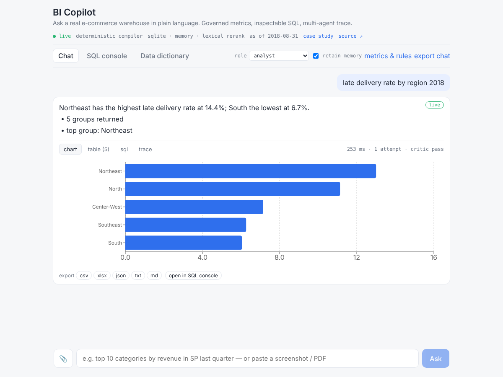
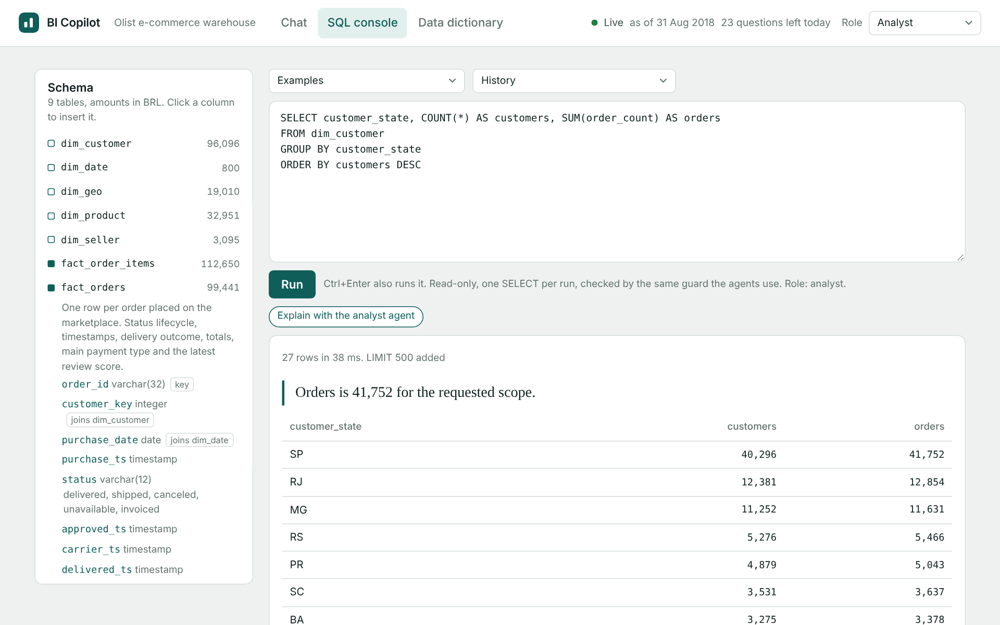
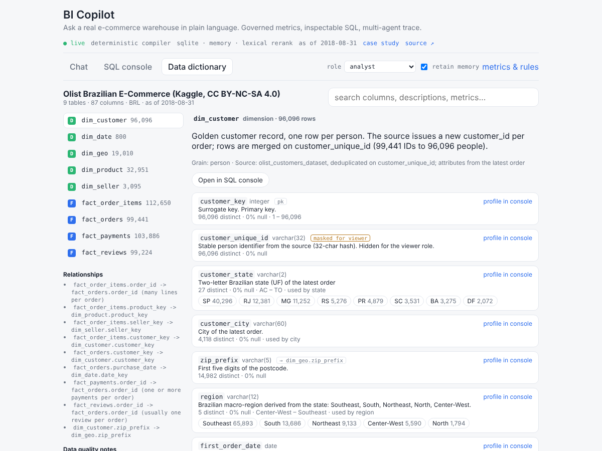
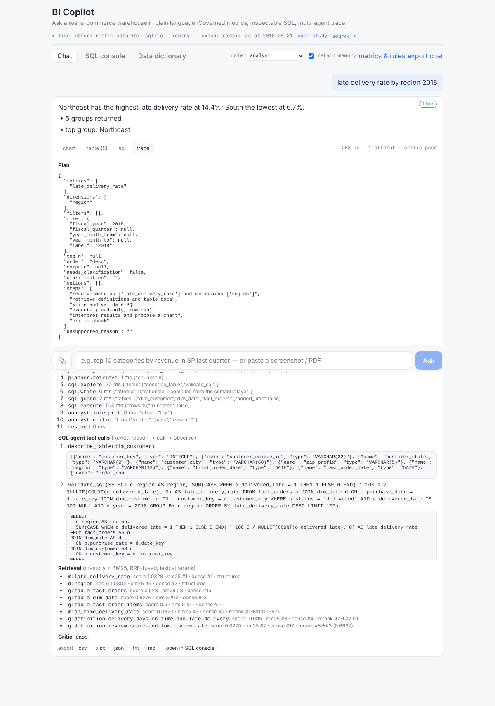

# bi-copilot

An intelligent-BI agent over a **real e-commerce warehouse**: ask in plain language, get a governed answer
(the number, the SQL that produced it, the rows, a chart, the agent trace) from a team of LangGraph agents.
Plus the things a BI team actually asks for: a guarded SQL console, a data dictionary, exports, pasted
PDFs and screenshots as context, and role-based masking.

```
"top 5 categories by revenue last quarter"
   -> planner  : metric=revenue, dimension=category, time=2018 Q2 ("last quarter" vs the as-of date 2018-08-31), top_n=5
   -> sql agent: describe_table(dim_product) -> validate_sql(...) -> SELECT p.category, SUM(oi.price) ... WHERE oi.status='delivered' AND d.year=2018 AND d.quarter=2 ... LIMIT 5
   -> analyst  : "watches_gifts leads revenue at BRL 293,016 (26% of the 5 groups shown)."  + bar chart spec
   -> critic   : pass
```



**The data is real.** [Olist's Brazilian E-Commerce dataset](https://www.kaggle.com/datasets/olistbr/brazilian-ecommerce)
(Kaggle, CC BY-NC-SA 4.0): 99,441 orders, 112,650 item lines, 96,096 customers, 3,095 sellers, 32,951 products,
99,224 reviews and a million geolocation points, September 2016 to August 2018, amounts in BRL. `data/build_olist.py`
turns the nine raw files into a star schema and makes the master-data problems in the source visible instead of
hiding them: the raw data issues a new `customer_id` per order, so a **golden customer record** merges 99,441 IDs
into 96,096 people (one person had 17); 547 orders carry duplicate reviews; 610 products have no category.

Everything the agents know about the business comes from a **semantic layer** (`semantic/metrics.yaml`): what
"revenue" means (delivered orders only, freight excluded, BRL), that "customers" are golden records and never
raw IDs, that "state" is the buyer's unless the question is about sellers. The model never guesses a definition.

Runs with **zero infrastructure** (SQLite, in-memory vectors, no API key: a deterministic compiler stands in for
the model) and with **Postgres + pgvector / Milvus + Redis + an LLM** for the real thing. Same code path either way.

## Detailed engineering case study

For background, architecture, a step-by-step request walkthrough, explanations of the terms (RAG, LangGraph,
RRF, ReAct, A2A), engineering decisions, evaluation evidence, limitations and interview questions, see
**[PROJECT_CASE_STUDY.md](PROJECT_CASE_STUDY.md)**. Deterministic evaluation results are a floor for the model
path, not measured LLM accuracy, and nothing here is a claim of business impact.

## What is in the box

| Piece | Where | What it does |
|---|---|---|
| Warehouse | `data/build_olist.py`, `data/schema.sql` | Olist raw files (committed zipped) -> `fact_orders`, `fact_order_items`, `fact_payments`, `fact_reviews`, `dim_customer` (golden record), `dim_seller`, `dim_product` (English categories + 10 groups), `dim_date`, `dim_geo` (per zip prefix) |
| Semantic layer | `semantic/metrics.yaml`, `semantic/glossary.md` | 20 governed metrics (GMV, freight ratio, AOV, basket size, customers, repeat rate, review score, low-review rate, on-time / late delivery, delivery days, cancellation rate, installments...), 17 dimensions with aliases and allowed values, 8 business rules, ambiguity map, two base tables with ordered joins |
| Data dictionary | `semantic/dictionary.yaml`, `src/bicopilot/dictionary.py` | Business description of every column + live profile (rows, distinct, null %, min/max, top values) + which metrics use it; served at `/dictionary`, shown in the UI, chunked into retrieval, and used to answer "which column tells me if an order was late?" |
| Field mapping | `src/bicopilot/semantic.py` | Phrase -> metric/dimension id, filter values (state codes need a cue, review scores need the word), calendar and relative time against an as-of date, top-N with "worst" following bad-is-high metrics, YoY/QoQ; ambiguous phrases ("delivery", "performance") become a clarifying question |
| Deterministic compiler | same | Plan -> SQL from the YAML alone, choosing the base table and pivoting order-grain metrics to item grain for product/seller slices. The LLM refines it; without an LLM it *is* the answer |
| Hybrid RAG + rerank | `src/bicopilot/retrieval.py`, `rerank.py` | BM25 + embeddings fused with RRF over glossary, metric/dimension cards and dictionary chunks, plus structured hits; reranked (LLM, flashrank cross-encoder or lexical). Vector store: memory, pgvector or Milvus |
| Multi-agent graph | `src/bicopilot/agents/` | Supervisor + planner / SQL / analyst sub-graphs on one shared state. Plan-and-Execute; ReAct with bound tools (`describe_table`, `sample_values`, `validate_sql`) and a repair loop; Reflection critic |
| SQL guard + executor | `src/bicopilot/sqlguard.py`, `db.py` | sqlglot parse, single SELECT, table allowlist, LIMIT, dialect transpile (SQLite, Postgres, MySQL, T-SQL, Snowflake); read-only run with timeout and row cap |
| Role masking | `src/bicopilot/access.py` | Viewer role hides columns flagged in the dictionary (customer IDs, review text) three ways: SQL rewrite on the AST, row post-filter, prompt note. Applies to chat and console |
| SQL console | `POST /sql`, `/sql/explain` | Hand-written SQL through the same guard and executor; the analyst agent explains a result set |
| Exports | `POST /export`, `/export/conversation` | CSV, XLSX (styled, About sheet), JSON, TXT, Markdown for any result; conversation as Markdown/JSON |
| Attachments | `POST /attachments` | PDF text (pypdf), CSV/text, images via the chat model's vision; extracted text rides with the question into the planner and SQL agent |
| Answer cache + limits | `cache.py`, `limits.py` | Redis or in-process cache keyed on question + as-of + role + semantic-layer hash; per-visitor and site-wide daily limits; Bearer-protected logs |
| A2A | `a2a.py`, `agents/reporting_agent.py`, `weekly-report.yml` | Agent Card + JSON-RPC `message/send`; a second agent compiles a weekly briefing and commits it |
| UI | `web/` | React + Vite + Recharts: Chat (answer, chart, table, SQL, trace, export, open-in-console, paste/drop attachments), SQL console (schema browser, history, explain, export), Data dictionary (search, profiles, masked flags), role switch, new chat |
| Eval | `eval/` | 60 questions with hand-written gold SQL over the real data; execution accuracy by tag -> `eval/report.md` |
| Tests | `tests/` | 58 tests: resolver, compiler, guard, tools, rerankers, Milvus store, cache, limits, fallback, console, masking, exports, attachments, admin analytics, graph, API, A2A. CI runs SQLite + Milvus Lite and Postgres + pgvector + Redis |





## Run it

```bash
git clone https://github.com/wenjun78/bicopilot.git && cd bicopilot
python -m venv .venv && source .venv/bin/activate     # .venv\Scripts\activate on Windows
pip install -e ".[dev]"
python data/build_olist.py       # unzips data/raw/olist.zip and builds the warehouse CSVs (~15 s)
python -m bicopilot              # API on http://127.0.0.1:8080  (POST /chat works immediately)
```

UI: `cd web && npm install && npm run build`, then restart the API and open http://127.0.0.1:8080.
For hot reload during UI work: `npm run dev` (proxies to the API on 8080).

With a model: `LLM_PROVIDER=openai`, `LLM_API_KEY=...`, `EMBEDDING_PROVIDER=openai`, `RERANKER=llm` in `.env`
(see `.env.example`). Any OpenAI-compatible endpoint works via `LLM_BASE_URL`. Image attachments need the model.

Postgres + pgvector + Redis: `docker compose up --build`, or set `DATABASE_URL`, `VECTOR_BACKEND=pgvector` and
`CACHE_URL=redis://...` against your own instances (Neon works). Milvus instead: `pip install -e ".[milvus]"` and
`VECTOR_BACKEND=milvus` (Milvus Lite file, or `MILVUS_URI`/`MILVUS_TOKEN` for a server or Zilliz Cloud).

```bash
make test        # pytest
make eval        # eval/run.py --min 0.8 -> eval/report.md
make report      # agents/reporting_agent.py over A2A -> report.md
python eval/export_demo.py   # pre-compute the static demo bundle (web/public/demo/results.json)
```

## How a question flows

```
                      ┌────────────┐
  question ─────────► │   router   │ greeting / meta (incl. "which column…" from the dictionary) / out-of-scope ──► respond
  (+ pasted PDF/      └─────┬──────┘
    image text)             │ data question
                 ┌──────────▼──────────┐
                 │   PLANNER agent     │  resolve (field mapping, attachment text) → plan (LLM corrects draft) → retrieve (hybrid RAG + rerank)
                 └──────────┬──────────┘
            needs clarification? ──────────────────────────────────────► respond (options)
                            │
                 ┌──────────▼──────────┐
                 │     SQL agent       │  explore (ReAct: describe_table / sample_values / validate_sql, ≤4 calls)
                 │                     │  → write (compiler draft + observations) → guard (+ viewer mask) → execute
                 │                     │       ▲                                        │ error
                 │                     │       └───────────── repair ◄─────────────────┘  (max 2)
                 └──────────┬──────────┘
            unrecoverable? ────────────────────────────────────────────► respond (error + attempts)
                            │
                 ┌──────────▼──────────┐
                 │   ANALYST agent     │  interpret (summary, insights, chart spec, caveats) → critic
                 └──────────┬──────────┘
            critic: revise ──────────────► back to SQL agent with a fix hint (max 1)
                            │ pass
                            ▼
                     respond (+ row post-filter for the viewer role)
```

Every node appends to a trace, so the UI shows which agent did what, the SQL agent's tool calls and observations,
which chunks were retrieved and why (BM25 rank, dense rank, rerank move, structured), every SQL attempt and the
critic's verdict.



## Design choices worth asking about

- **Governed metrics, not free-form text-to-SQL.** Text-to-SQL on a raw schema fails on *meaning* ("revenue"
  with canceled orders in it, "customers" counted on per-order IDs) long before it fails on syntax. The resolver
  maps language to metric ids; the compiler emits the metric's canonical expression, mandatory filters and base
  table; the LLM is asked to *refine* a correct draft. Hallucinated columns cannot survive the guard.
- **The golden record is the point.** The source's per-order customer IDs are exactly the master-data problem
  a BI team meets first; the loader resolves it once and the semantic layer says "customers means golden records",
  so every agent counts people, not orders.
- **Clarify, don't guess.** "delivery" maps to delivery days or on-time rate; "performance" to three metrics.
  The planner returns options, the UI renders chips, the follow-up is merged with the pending question.
- **Relative time against an as-of date** (2018-08-31, the last complete month): "last quarter" is 2018-Q2, YoY
  on an explicit year compares full years, YoY on "this year" compares year-to-date windows. The answer says what
  it resolved to.
- **Masking is three layers, not one.** A viewer's SQL has masked columns replaced on the AST before it runs, the
  rows are post-filtered after, and the prompts tell the agents not to describe them. The console and the chat
  share all three.
- **The deterministic path is the test oracle.** 60 questions have hand-written gold SQL; the eval compares
  *result sets*. The compiler scores 100 %, which is the floor the model path must meet.
- **A2A as a first-class surface.** `reporting_agent.py` has no database access; it only has the Agent Card.

## Deploy

**API on Render (free tier).** render.com → New → Blueprint → this repo; paste your OpenAI key into `LLM_API_KEY`
(everything else is pre-filled). The image builds the Olist warehouse from the committed zip at build time.
`python scripts/smoke_live.py https://<service>.onrender.com` checks health, three questions, a clarification
round trip and the agent card. Free-tier services sleep after 15 idle minutes; the UI polls `/healthz` for up to
90 s while the server wakes and answers from the pre-computed bundle meanwhile. The API binds its port at once and
builds the copilot in the background (`/healthz` answers 503 `starting` until then); the first start on a fresh
database loads the warehouse with `COPY`, profiles the columns and embeds the chunks, and caches the last two,
so later cold starts take seconds. A warehouse built for an older schema is detected by version and rebuilt. Public-exposure controls set by
the blueprint: 6 questions/minute and 25/day per visitor (hashed IP), 300 model-backed answers/day site-wide,
`/runs` behind `ADMIN_TOKEN`.

**UI on GitHub Pages**: `.github/workflows/pages.yml` builds `web/` and publishes to `https://<user>.github.io/bicopilot/`;
the same build is copied into the portfolio site. Without a reachable API the page serves the pre-computed bundle
(chat only); the SQL console, dictionary and attachments need the live API.

## Repository map

```
semantic/        metrics.yaml (the contract), glossary.md (RAG chunks), dictionary.yaml (column meanings)
data/            schema.sql, build_olist.py, raw/olist.zip (source, CC BY-NC-SA 4.0), csv/ (built)
src/bicopilot/   config, db, semantic, dictionary, retrieval, rerank, tools, cache, limits, access, export,
                 attachments, sqlguard, llm, prompts, service, api, a2a, analytics
src/bicopilot/agents/  state, planner, sql_agent, analyst, graph (supervisor)
agents/          reporting_agent.py (second agent, talks A2A)
eval/            questions.jsonl, run.py, export_demo.py, report.md
tests/           58 tests
web/             React UI (Vite). web/dist is served by the API at /
admin/           Authenticated analytics dashboard UI (HTML, CSS, JavaScript)
```


## Render blueprint and private owner analytics

The following describes **settings committed in [render.yaml](render.yaml), not a verified snapshot of live Render environment variables**. Values changed in Render's Environment tab take precedence. Open `/healthz` to inspect the running LLM implementation, retrieval backend, and SQL dialect; the health endpoint does **not** expose the configured model ID, credentials, or database URL.

| Area | Configuration in the Render Blueprint |
|---|---|
| Application | [bicopilot.onrender.com](https://bicopilot.onrender.com/) · Docker/FastAPI serving React · Singapore · free web service |
| LLM | `LLM_PROVIDER=openai`, `LLM_MODEL=gpt-5.6-sol`, `LLM_REASONING_EFFORT=low` |
| Credentials | `LLM_API_KEY` supplied privately in Render; the same OpenAI key is used for model calls and OpenAI embeddings |
| Retrieval | `EMBEDDING_PROVIDER=openai`; embedding model default `text-embedding-3-small`; `RERANKER=llm` |
| Vector storage | `VECTOR_BACKEND=pgvector` when connected to a compatible PostgreSQL database; otherwise in-memory vector retrieval |
| Warehouse and run history | `DATABASE_URL` optional: bundled SQLite (Olist warehouse built into the image) works without Neon; PostgreSQL can persist run and visitor records |
| Cache | `CACHE_URL=memory` (process-local cache) |
| Traffic limits | 6 questions per minute and 25 per day per client, plus 300 non-cached model requests per UTC day site-wide |
| Security | `ADMIN_TOKEN` and `SECRET_SALT` generated by the Blueprint; `CORS_ORIGINS=https://wenjun78.github.io`; one trusted reverse-proxy hop |
| Fallback | A model failure can trigger the **labelled deterministic compiler**; a successful fallback is not proof of a successful OpenAI invocation |

A model name in the Blueprint is a *requested* model, not proof that the provider accepted it or that the model produced a specific answer. Confirm the model is available to the API project and check live request traces for `llm`, error/fallback labels, and test outcomes. The app's default **no-key local** settings instead use a deterministic fake LLM, hash embeddings, lexical reranking, SQLite, and in-memory vectors.

### Admin dashboard and visitor telemetry

- **Dashboard:** [https://bicopilot.onrender.com/admin](https://bicopilot.onrender.com/admin). The HTML login screen is accessible publicly, but data endpoints require the `ADMIN_TOKEN` from Render → Environment. The dashboard holds the entered token only in the current browser tab's JavaScript memory; do not publish or commit it.
- **Protected APIs:** `GET /admin/api/overview?days=7|30|90` for trends, counts, referrers, and status metrics; `GET /runs?limit=100` and `GET /runs/{id}` for recorded questions and traces. They require `Authorization: Bearer <ADMIN_TOKEN>`; when the token is unset, admin data requests fail closed.
- **Recorded data:** `copilot_runs` stores submitted questions, answers, SQL, status, timestamps, session ID, execution duration, and trace. `copilot_visits` stores page-load events, timestamps, referral hostname, session ID, and a salted hash of a browser-generated identifier. The app does not store visitors' names or raw IP addresses in those analytics tables.
- **Dashboard metrics:** Approximate unique browsers, page views, questions, answered requests, cached requests, response time, traffic sources, recent visits, and daily activity. Browser identifiers are **not verified individual people**, and static/offline demo answers do not generate backend question records.
- **Persistence:** SQLite runs locally or without a Neon connection, but logs on Render's ephemeral filesystem may disappear after redeployment or restart. For durable history, create a **separate `bicopilot` database in the same Neon project as Ask WJ**, then configure BI Copilot's `DATABASE_URL` with `postgresql+psycopg://...`. Existing local SQLite logs are not migrated automatically.
- **Verification:** The dashboard was implemented in `admin/`, `src/bicopilot/analytics.py`, `src/bicopilot/api.py`, and the React pageview client. CI tests cover the dashboard and access controls; **successful CI does not itself confirm the latest commit is deployed on Render**. A 404 on `/admin` indicates the running service is not serving the route.

## Limits

- One company's data, one currency, 2016-2018; relative periods are pinned to the as-of date, so "this year" is 2018.
- The compiler covers breakdowns, filters, time, top-N and YoY/QoQ on one base table; cross-base questions pivot
  through the orders join, and anything beyond that is left to the model path.
- Review text is Portuguese; only category names are translated. Images need a vision-capable model key.
- Olist's licence is non-commercial (CC BY-NC-SA 4.0); this is a portfolio project.

## License

Code: MIT, (c) wjun78. Data: Olist, CC BY-NC-SA 4.0 (see `data/raw/olist.zip`).
